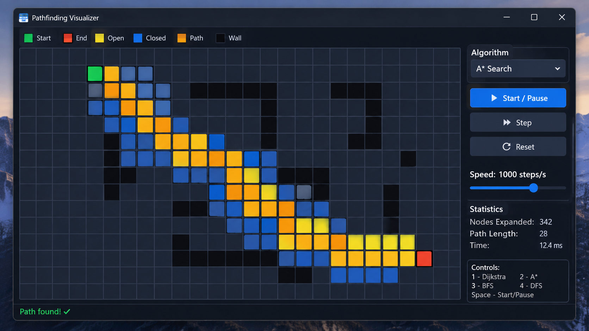

# Pathfinding Visualizer
<p align="center">  </p>
A C++17 desktop visualizer for Dijkstra, A*, breadth-first search, and iterative depth-first search. Search runs once to record a deterministic event stream; the animator replays it independently of frame rate.

## Features

- Four-connected grid with draggable Start and End markers, wall painting, and seeded random obstacles.
- Pause, resume, single-step, and eight playback speeds (10 to 5000 steps/s).
- Batched SFML vertex-array rendering with per-cell dirty color updates.
- Search statistics, compact color legend, and optional controls overlay.
- BFS, Dijkstra, and A* find shortest paths for uniform edge costs; DFS may return a longer path.

## Controls

| Key / input | Action |
|---|---|
| Space | Start, pause, or resume |
| 1 / 2 / 3 / 4 | Dijkstra / A* / BFS / DFS |
| Left mouse | Draw/erase walls, or drag Start/End |
| Right mouse | Erase walls |
| C / W / R | Clear path / clear walls / reset grid |
| M | Generate seeded random obstacles |
| Up / Down | Increase / decrease playback speed |
| Right | Single step while paused (starts paused when idle) |
| H | Toggle controls help |
| Esc | Quit |

## Architecture

```text
+---------------------------+
| App / SFML event loop     |
+-------+-----------+-------+
        |           |
 +------v----+  +---v------------+
 | Input     |  | GridRenderer /  |
 | Handler   |  | HUD             |
 +------+----+  +----------------+
        |               ^
 +------v---------------+----+
 | Grid (SFML-free)          |
 +-------------+-------------+
               ^
 +-------------+-------------+
 | IPathfinder implementations|
 | BFS / DFS / Dijkstra / A*   |
 +----------------------------+
```

## Build

CMake first looks for SFML 2.6. If unavailable, it fetches SFML 2.6.1 (network access is then required).

### Linux

```sh
sudo apt install build-essential cmake libsfml-dev
cmake -S . -B build
cmake --build build -j
ctest --test-dir build --output-on-failure
./build/PathfindingVisualizer
```

### macOS

```sh
brew install cmake sfml
cmake -S . -B build
cmake --build build -j
./build/PathfindingVisualizer
```

### Windows (vcpkg)

```powershell
vcpkg install sfml:x64-windows
cmake -S . -B build -DCMAKE_TOOLCHAIN_FILE=C:/path/to/vcpkg/scripts/buildsystems/vcpkg.cmake
cmake --build build --config Release
.\build\Release\PathfindingVisualizer.exe
```

Alternatively, configure with Visual Studio and allow CMake FetchContent to download SFML 2.6.1.

## Font

Place a TrueType font at `assets/font.ttf` to provide the HUD font. The application tries common system fonts if that file is absent. Without an available font, the grid remains usable and HUD text is disabled with a diagnostic on stderr.

## Adding an algorithm

Implement `IPathfinder` in a header and source file. `solve(const Grid&)` should leave the grid untouched and return chronological `StepEvent`s plus its `SearchResult` statistics. Add the source to `pfv_core`, include the class in `src/Pathfinder.cpp`, and register it in `makePathfinder`. Add a selector key in `App::handleKey` if it should be reachable from the UI.
